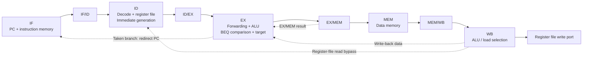
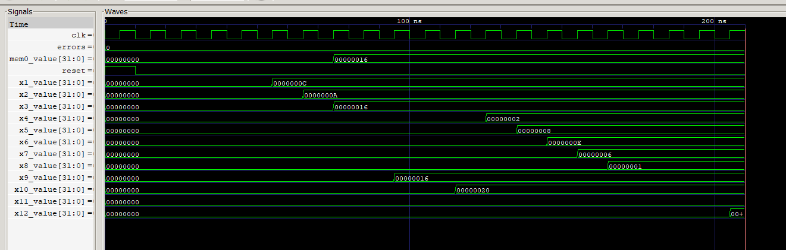
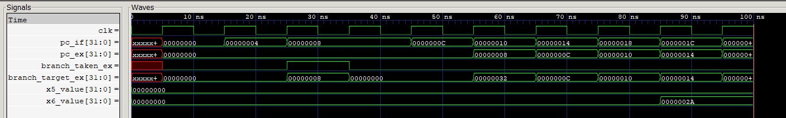

# 5-Stage Pipelined RISC-V CPU

A 32-bit, five-stage pipelined processor implemented in Verilog, supporting ten selected RV32I instructions. The project explores how forwarding, pipeline stalls, and branch flushing preserve correct execution when instructions overlap.

The design includes PC-based instruction fetch, separate instruction and data memories, source-aware load-use hazard detection, same-cycle register-file write-back bypass, and directed self-checking testbenches. Development notes trace the implementation from individual RTL modules to mixed-program verification.

**Start here:** [Architecture](#architecture) · [Design decisions](#design-decisions) · [Run a simulation](#quick-start) · [Verification](#verification) · [Development notes](#development-notes)

## Project at a glance

| Item | Implementation |
| --- | --- |
| Datapath | 32-bit; IF → ID → EX → MEM → WB |
| Instruction subset | ADD, SUB, AND, OR, XOR, SLT, ADDI, LW, SW, BEQ |
| Data dependencies | EX/MEM and MEM/WB forwarding, including store data |
| Register-file reads | Same-cycle write-back bypass on both read ports; x0 remains zero |
| Load-use hazards | Hold PC and IF/ID; insert an ID/EX bubble |
| Branches | BEQ resolved in EX using forwarded operands |
| Taken-branch recovery | Redirect PC; flush IF/ID and ID/EX |
| Memories | Separate 256 × 32-bit instruction and data arrays |
| Verification | Eight core directed self-checking testbenches; additional module-level tests |
| Tools | Icarus Verilog, `vvp`, GTKWave |

This is an architectural learning project implementing a **selected RV32I subset**. It does not implement the complete ISA, and the results presented here concern RTL simulation.

## Architecture



The diagram shows the main datapath and forwarding routes. Hazard and flush controls are summarized below.

| Condition | PC | IF/ID | ID/EX |
| --- | --- | --- | --- |
| Normal execution | Advance by 4 | Capture instruction | Capture decoded values |
| Immediate load-use dependency | Hold | Hold | Insert bubble |
| Taken BEQ | Load branch target | Flush | Flush |

Instruction fetch is combinational. Data memory uses combinational reads and synchronous writes. Both memories select words using `address[9:2]`; the testbenches initialize programs and required register/memory state directly.

Read the integration in [pipeline_top.v](RTL/pipeline_top.v), then follow the [register file](RTL/register_file.v), [forwarding unit](RTL/forwarding_unit.v), [hazard detector](RTL/hazard_detection_unit.v), and [instruction decoder](RTL/instruction_decoder.v).

## Design decisions

### Forward values to both operands and the store-data path

The forwarding unit selects the newest available result independently for each EX-stage source. EX/MEM takes priority over MEM/WB, and destination register `x0` is excluded.

The forwarded second operand feeds both the ALU-side selection and the store-data path, allowing sequences such as:

```assembly
addi x5, x0, 10
sw   x5, 0(x2)
```

The store uses the updated value of `x5`. See the [store-forwarding test](Testbench/pipeline_store_forwarding_tb.v).

### Handle write-back and register reads in the same cycle

The register file writes on the rising clock edge. ID/EX also captures decoded operands on that edge, so reading only the register array can capture an old value when ID reads the register being written by WB.

Both read ports now return `write_data` directly when `write_enable` is asserted and the write address matches the read address. Reads of `x0` still return zero.

The final mixed-program test includes:

```assembly
addi x13, x0, 7
addi x14, x0, 1
addi x15, x0, 2
add  x16, x13, x13
```

The two independent ADDI instructions place the final ADD's ID stage in the same cycle as the first ADDI's WB stage. Both read ports must receive 7, producing **x16 = 14**.

This check extends [pipeline_final_tb.v](Testbench/pipeline_final_tb.v), alongside the original arithmetic, memory, and branch checks.

### Distinguish real load-use dependencies from immediate bits

An early load-use detector compared the pending load destination against both source-field positions in the next instruction. For ADDI and LW, however, bits in the apparent `rs2` position belong to the immediate.

The decoder now provides `uses_rs1` and `uses_rs2`, so only actual source operands can trigger a stall. For example, in `lw x5, 0(x0)` followed by `addi x6, x0, 5`, the immediate's low five bits resemble register index 5, but the ADDI does not read `x5`.

The [hazard unit test](Testbench/hazard_detection_unit_tb.v) includes an unused-`rs2` match that must not stall, alongside genuine dependencies and `x0` exclusion. [Day 18](docs/notes/day18.md) records this refinement.

A genuine adjacent load-use sequence still requires a bubble:

```assembly
lw  x5, 0(x2)
add x6, x5, x3
```

### Resolve branches with forwarded operands

BEQ compares the forwarded source values in EX and calculates its target as `pc_ex + immediate_ex`. A taken branch redirects fetch and clears younger instructions in IF/ID and ID/EX.

The [branch-fetch test](Testbench/pipeline_branch_fetch_tb.v) initializes `x1 = x2 = 5` and runs:

```assembly
beq  x1, x2, +8
addi x5, x0, 99
addi x6, x0, 42
```

With `x5` and `x6` initially zero, the expected result is `x5 = 0` and `x6 = 42`: the wrong-path write is suppressed and the target instruction executes.

## Quick start

Install Icarus Verilog with `iverilog` and `vvp` available on your PATH. GTKWave is optional for waveform inspection. The commands below use **PowerShell**.

Clone the repository and enter its root:

```powershell
git clone https://github.com/BrianPYXU/riscv-5stage-cpu.git
Set-Location riscv-5stage-cpu
```

Compile and run the mixed-program test:

```powershell
New-Item -ItemType Directory -Force build | Out-Null
$rtl = @(Get-ChildItem -LiteralPath RTL -Filter '*.v' | ForEach-Object { $_.FullName })
iverilog -g2012 -s pipeline_final_tb -o build/pipeline_final.vvp @rtl Testbench/pipeline_final_tb.v
if ($LASTEXITCODE -ne 0) { throw 'Compilation failed; check the compiler output.' }
vvp build/pipeline_final.vvp
if ($LASTEXITCODE -ne 0) { throw 'Simulation failed; check the simulator output.' }
```

Expected success message:

```text
ALL FINAL MIXED PIPELINE TESTS PASSED
```

The testbench writes `pipeline_final.vcd` to the current working directory, which is the repository root in this example. Open it with:

```powershell
gtkwave pipeline_final.vcd
```

The `-s` option selects one testbench as the simulation top. To run another core test, replace the top name, testbench path, and output filename using the table below.

Current testbenches print their own PASS/FAIL messages; a zero simulator exit code alone does not establish that all checks passed.

## Verification

The core regression suite comprises eight directed self-checking testbenches:

| Testbench | Main checks |
| --- | --- |
| [hazard_detection_unit_tb](Testbench/hazard_detection_unit_tb.v) | True load-use dependencies, unused-source filtering, x0 exclusion |
| [forwarding_unit_tb](Testbench/forwarding_unit_tb.v) | Operand selection and EX/MEM priority over MEM/WB |
| [pipeline_logic_tb](Testbench/pipeline_logic_tb.v) | AND, OR, XOR, SLT, including a signed comparison |
| [pipeline_load_use_tb](Testbench/pipeline_load_use_tb.v) | Final register values for an adjacent LW → ADD dependency |
| [pipeline_store_forwarding_tb](Testbench/pipeline_store_forwarding_tb.v) | Store receives the preceding ADDI result |
| [pipeline_branch_tb](Testbench/pipeline_branch_tb.v) | BEQ taken and not-taken decisions |
| [pipeline_branch_fetch_tb](Testbench/pipeline_branch_fetch_tb.v) | Wrong-path suppression and branch-target execution |
| [pipeline_final_tb](Testbench/pipeline_final_tb.v) | Mixed arithmetic, logic, memory and branches; same-cycle WB/ID reads on both source ports |

The WB/ID case is part of the existing final mixed-program test, so the core suite still contains eight testbenches. These are directed functional checks; the table describes their test scope rather than an ISA-compliance result or a coverage percentage.

Additional tests under [Testbench/](Testbench/) exercise individual modules. Some use waveform inspection or printed signals rather than automatic assertions.

### Mixed-program result

The final program combines all ten supported instructions, stores and reloads a result, exercises a load-use dependency, and skips a wrong-path register write. Four appended instructions check same-cycle write-back and register reads.

| Architectural state | Expected value | Purpose |
| --- | ---: | --- |
| x1 / x2 | 12 / 10 | Initial ADDI results |
| x3 | 22 | Dependent arithmetic result |
| memory[0] and x9 | 22 | Store/load consistency |
| x10 | 32 | Load-use dependent addition |
| x4 / x5 / x6 / x7 / x8 | 2 / 8 / 14 / 6 / 1 | SUB / AND / OR / XOR / SLT |
| x11 / x12 | 0 / 42 | Wrong-path suppression / target execution |
| x13 | 7 | Value written back during the final ADD's ID stage |
| x14 / x15 | 1 / 2 | Independent instructions spacing the WB/ID case |
| x16 | 14 | Both source operands read the current x13 write-back value |

The full initialization and checks are in [pipeline_final_tb.v](Testbench/pipeline_final_tb.v). The updated test waits 300 ns after reset is released, then compares the expected register and memory values using `!==`. Unknown values therefore count as errors, alongside incorrect known values. The `errors` counter determines the printed PASS/FAIL result.

### Representative waveforms

**Mixed-program execution**



The updated capture includes x13–x16 and the write-back/read signals. During the bypass case, `rd_wb`, `rs1_id`, and `rs2_id` are all `0D` (x13), while `wb_data`, `read_data1_id`, and `read_data2_id` are 7. The final ADD later writes `0000000E` (decimal 14) to x16.

Instruction locations beyond the loaded program are uninitialized, so decode and read signals may show X values after the program has completed. The expected-state table refers to the registers and memory checked by the testbench.

**Branch-target fetch**



The corresponding test checks that the skipped instruction leaves `x5` unchanged and that the branch-target instruction writes `x6 = 42`.

More captures, including forwarding and hazard-unit simulations, are available in [docs/waveforms/](docs/waveforms/).

## Supported instructions

| Class | Instructions | Behavior |
| --- | --- | --- |
| Register arithmetic | ADD, SUB | 32-bit addition and subtraction |
| Register logic | AND, OR, XOR | Bitwise operations |
| Comparison | SLT | Signed less-than; writes 0 or 1 |
| Immediate arithmetic | ADDI | Addition with a sign-extended immediate |
| Memory | LW, SW | Word load and store |
| Control flow | BEQ | PC-relative branch when operands are equal |

## Repository guide

| Location | Contents |
| --- | --- |
| [RTL/](RTL/) | Datapath, pipeline registers, memories, decoding, and hazard controls |
| [Testbench/](Testbench/) | Directed module and pipeline tests |
| [docs/notes/](docs/notes/) | Eighteen incremental development notes |
| [docs/waveforms/](docs/waveforms/) | Saved GTKWave captures |

### Development notes

The notes preserve the project as it evolved; early entries describe the implementation at that point in development. The [Day 18 postscript](docs/notes/day18.md#postscript-write-back-bypass-and-final-test-extension) records the later write-back bypass and mixed-program test extension.

- [Day 1: RTL fundamentals](docs/notes/day01.md)
- [Day 6: Initial datapath integration](docs/notes/day06.md)
- [Day 7: Pipeline organization](docs/notes/day07.md)
- [Day 13: Forwarding unit](docs/notes/day13.md)
- [Day 14: Memory access and load-use hazards](docs/notes/day14.md)
- [Day 15: Branch handling and store-data forwarding](docs/notes/day15.md)
- [Day 16: PC-based instruction fetch](docs/notes/day16.md)
- [Day 17: Logic instructions and regression organization](docs/notes/day17.md)
- [Day 18: Mixed-program verification and hazard refinement](docs/notes/day18.md)

## Current scope and next steps

The implementation is a simulation-oriented processor model. Register and memory initialization is supplied by the testbenches; the repository does not establish FPGA deployment, timing closure, or measured performance.

The memory arrays use only `address[9:2]`, without alignment or out-of-range traps. The supported instruction subset omits features such as jumps, other branch conditions, byte/halfword memory operations, and architectural exception handling.

Priorities for further development:

- Extend the final test's explicit unknown-value checks to the remaining automatic tests, and make test failures return a nonzero exit status.
- Add cycle-level stall/flush checks, negative branch offsets, and further WB/ID cases involving loads, stores, and branches.
- Automate regression execution.
- Evaluate synthesis and timing with a defined target and workload before making area, frequency, or CPI claims.

